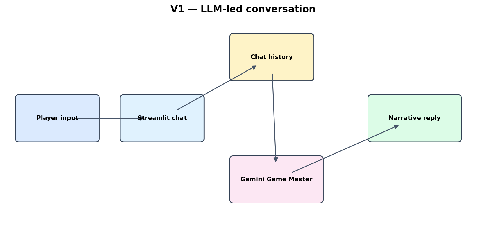
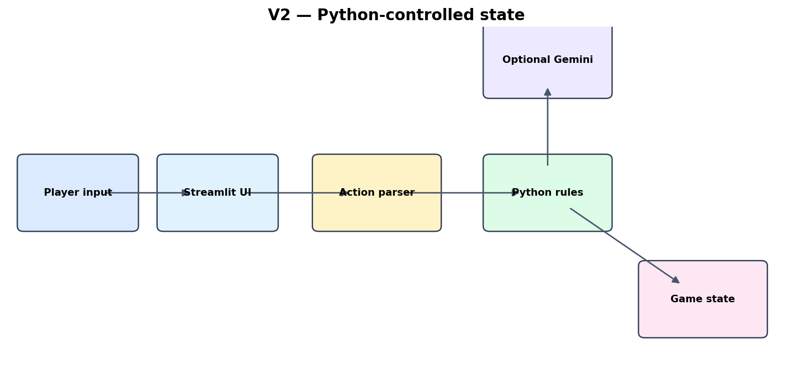

# Subsea Research Station — Technical Summary

| Object | Function |
|---|---|
| Sonar panel | Reveals 2741 |
| Specimen cabinet | 2741 grants magnetic key + calibration card |
| Control console | Calibration card reveals 6308 |
| Oxygen valve | Must be SAFE |
| Escape hatch | Key + SAFE pressure + 6308 |

| Area | V1 | V2 |
|---|---|---|
| Progress | Conversation context | Python state |
| Validation | LLM instruction | Python rules |
| Inventory | Narrative | Structured set |
| AI role | Game master | Optional narration |

| Test | Input | Expected result |
|---|---|---|
| Sonar clue | Inspect sonar | Code 2741 revealed |
| Premature cabinet | Enter 2741 before sonar | Cabinet remains locked |
| Wrong code | Enter 1111 | Cabinet remains locked |
| Missing key | Use key before collection | Hatch remains locked |
| Console without card | Activate console early | Console refuses |
| Prompt injection | Claim administrator / ignore rules | Request rejected |
| Restart | Restart after collecting items | State and inventory cleared |

Windows: `py -3.11 -m venv .venv` → `.venv\Scripts\Activate.ps1` → `pip install -r requirements.txt` → `streamlit run version2/app.py`.
